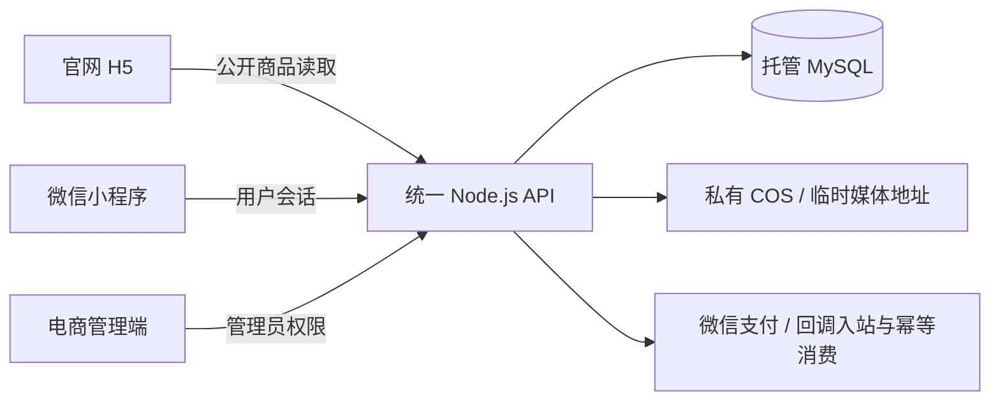

# SRAVX｜宠物美容工具电商系统

面向宠物美容师的品牌官网、微信小程序与电商管理端，共用服务器业务接口。项目从早期CloudBase方案逐步迁移到独立API、托管MySQL及私有COS，覆盖商品维护、跨端展示、订单与售后等业务。

**在线演示：[sravxpet.com](https://sravxpet.com/)** · **[面试展示与技术复盘](docs/project-showcase.md)** · **[真实项目状态](docs/project-status-and-next-tasks.md)**

官网展示与商品公开读取已上线；网页登录认证及完整网页支付流程尚未验收。页面中的本地演示素材不代表可交易商品。请勿在演示中提交真实订单、支付或退款。

## 值得关注的实现

- **商品上传一次，两端读取**：管理端维护同一商品，网页/小程序共用分类、规格价格、参数与媒体适配；缺失价格、无库存或接口失败不会静默转成另一份数据。
- **明确的数据建模**：保留统一商品主体，通过分类关联表及索引表达Basic/Pro/Master/配件与剪型，避免按四个系列复制商品表。质保等字段按产品类型约束。
- **服务器交易边界**：订单金额/库存/身份由服务器校验；支付回调验签、持久化入站与幂等消费，退款接受与完成分开表示。源码和测试不等同所有交易场景已生产验收。
- **私有图片访问**：数据库保留对象引用，由后端为可见目录生成临时HTTPS地址，前端在过期时重新读取；签名链接不覆盖数据库对象键。
- **交互和交付**：H5专属剪刀展示支持鼠标拖动、滚轮、触摸、键盘、暂停与减少动画；独立Nginx官网站点、HTTPS自动续期、制品哈希校验和实际Chrome验证。

## 技术与模块

| 模块 | 主要技术 | 职责 |
|---|---|---|
| 官网 / 小程序 | UniApp、Vue 3、Vite | 品牌展示、商品选配与用户页面 |
| 管理端 | Vue 3、TypeScript、Vue Router、Element Plus | 通用/网页/小程序工作区，商品与订单售后管理 |
| API | Node.js、HTTP、领域仓储 | 会话、权限、校验、事务和统一接口 |
| 数据 / 媒体 | 托管MySQL、私有COS | 业务事实与对象文件分离 |
| 发布 / 验证 | Nginx、Let’s Encrypt、Node Test Runner、Playwright驱动Chrome | 站点发布、回归与浏览器核验 |

## 验证快照（2026-10-14）

| 检查 | 本次结果 |
|---|---|
| API单元/路由测试 | 175项通过 |
| 官网/小程序共用逻辑测试 | 101项通过 |
| 管理工作区/接口适配测试 | 10项通过 |
| 管理端 | 类型检查与生产构建通过，保留已知大分块警告 |
| 小程序 | 26页构建及服务器接口/返回入口制品核验通过；不代表微信真机全流程验收 |
| 官网 | 113个公网静态文件摘要一致；桌面/移动展示、导航、真实商品读取与刷新检查通过 |

这些数字是当日执行结果，不是覆盖率、并发性能或持续集成承诺。发布证据见[官网发布记录](docs/website-release-2026-10-14.md)；历史文档中的待完成项按日期阅读。

## 代码导航

主开发目录：`E:\sravxapp`。`D:\saven` 仅为历史备份，后续代码修改、提交与推送均在 E 盘执行。

| 目录 | 内容 |
|---|---|
| `sravx/` | 当前官网 H5 与微信小程序 UniApp 源码 |
| `server/` | 目标 API、数据库迁移、后端测试 |
| `admin-web/` | 管理端 Vue 前端 |
| `docs/` | 项目状态、架构、迁移执行计划与证据 |
| `miniprogram/`、`cloudfunctions/`、`cloudrun/` | 旧系统兼容源码与历史参考 |

先阅读 [项目状态](docs/project-status-and-next-tasks.md)、[主开发目录约定](docs/workspace-primary-e-drive.md) 与 [执行规则](AGENTS.md)。生产迁移仍遵循 [迁移执行计划](docs/cloudbase-to-cloud-server-migration-plan.md)。

## 开发与核验入口

| 模块 | 开发 / 检查 | 制品 |
|---|---|---|
| 官网 | `sravx` 内 `npm run dev:h5`；`node --test scripts/*.test.mjs`；`npm run build:h5` | `sravx/dist/build/h5` |
| 微信小程序 | `sravx` 内 `npm run build:mp-weixin`，或HBuilderX编译 | `sravx/dist/build/mp-weixin` |
| 管理端 | `admin-web` 内 `npm run dev`、`npm run build`（包含类型检查） | `admin-web/dist` |
| 后端 | `server` 内 `npm test` | 后端源码须单独审批发布，不随官网上传 |

官网展示入口为 `/#/pages/welcome/index`，原首页为 `/#/pages/index/index`。四张剪刀演示素材仅供展示，不是可下单的后台商品；公开目录与商品详情读取统一后端。

各模块遵循锁文件安装依赖，环境配置单独管理。源码、测试和脱敏文档可进入Git；依赖、构建制品、密钥、用户资料、生产日志和 `.local-backup` 不进入Git。整理不等于删除历史系统，旧目录保留到明确批准退役。

官网上线流程与本次状态见 [官网发布记录](docs/website-release-2026-10-14.md)。网页上线、GitHub推送、小程序发布、API更新是四个独立动作，不自动同时执行。
