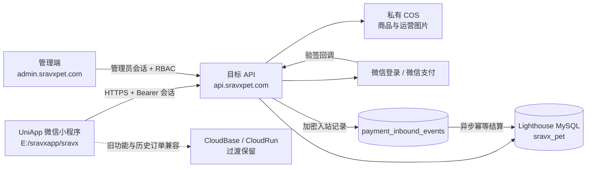

# SRAVX 当前系统架构

更新日期：2026-09-22。本文描述当前部署和代码结构；旧 CloudBase 架构仅作为兼容与历史参考，不能作为新功能的实现依据。

## 系统边界

## 运行入口

| 入口 | 地址或位置 | 职责 |
|---|---|---|
| 用户 API | `https://api.sravxpet.com/api/v1/*` | 小程序登录、目录、用户资料、地址、订单及支付接口。 |
| 管理端 | `https://admin.sravxpet.com` | 管理员登录、目录维护、运营操作。 |
| API 服务 | `/opt/sravx-api`，systemd 服务 `sravx-api` | Node.js 业务服务，仅监听本机回环地址，由 Nginx 转发。 |
| 业务库 | `sravx_pet` | 用户基础资料和新系统产生的业务数据。 |
| 私有对象存储 | COS Bucket `sravx-1419382340` | 新商品和运营媒体；由 API 生成上传许可和访问地址。 |
| 旧系统 | `D:/saven/miniprogram`、`cloudfunctions`、`cloudrun` | CloudBase 兼容、历史订单和旧支付链路参考；尚未退役。 |

## 小程序代码导航

当前交付源码：`E:/sravxapp/sravx`。

| 位置 | 说明 |
|---|---|
| `common/api.js` | 唯一业务接口适配层。功能开关决定目标 API 或 CloudBase 兼容调用，不在页面中直接拼接后端地址。 |
| `common/auth.js` | 本地会话和登录状态处理。 |
| `pages/confirm-order/index.vue` | 普通订单与积分订单提交入口。 |
| `pages/order-list/index.vue` | 合并显示历史 CloudBase 订单和目标库新订单。 |
| `pages/order-detail/index.vue` | 普通订单详情、取消、收货、支付与退款申请。 |
| `pages/points-order-detail/index.vue` | 积分订单详情；现金补差支付请求可在目标订单演练构建中切换。 |
| `pages/coupon-manage/index.vue` | 新优惠券活动领取和个人优惠券展示。 |
| `pages/gift-card-redeem/index.vue` | 新礼品卡兑换与地址确认。 |
| `vite.config.ts` | UniApp/Vite 构建兼容配置。 |
| `package.json` | `target-safe`、`target-services`、`target-orders-rehearsal` 与 `structured-checkout-rehearsal` 验证构建命令。 |

构建产物 `dist/build/mp-weixin` 仅供微信开发者工具运行，不是源代码，也不保存业务数据。

## API 代码导航

当前后端源码：`D:/saven/server`。

| 位置 | 说明 |
|---|---|
| `src/main.js` | 服务进程启动入口。 |
| `src/runtime.js` | 将环境配置、MySQL、COS、会话、支付和业务仓储装配为运行时服务。 |
| `src/server.js` | HTTP 路由、认证、输入边界、统一错误响应和管理员 RBAC 入口。 |
| `src/auth/` | 微信 code 登录、手机号绑定和管理员登录服务。 |
| `src/repositories/` | MySQL 数据访问；按用户、目录、订单、支付、优惠券、剪刀等业务拆分。`mysql-structured-checkout-repository.js` 为 SKU/报价订单的受开关实现，依赖未执行的 `012` 迁移。 |
| `src/payments/` | 微信支付 JSAPI 下单、验签、回调解密、入站账本和异步结算消费者。 |
| `src/media/` | 私有 COS 上传许可、媒体对象确认和对象键约束。 |
| `src/observability/` | 请求 ID 与脱敏审计日志。 |
| `migrations/` | 编号数据库结构迁移；运行时不得自动建表或改表。 |
| `test/` | 单元与路由测试；最近一次通过 132 项。 |

## 数据与支付规则

1. 旧商品、订单、地址、积分、优惠券、礼品卡和剪刀历史数据不导入目标库；只保留获准的用户基础资料与身份绑定。
2. 订单、库存、优惠券和积分变更必须由服务器事务决定，客户端不可提交金额、OpenID 或库存结论。
3. 微信支付回调先验签并加密写入 `payment_inbound_events`，消费者随后以交易唯一键结算订单。
4. 当前支付回调账本与业务库共用同一 MySQL 数据库，这是已确认的单库部署选择；必须监控数据库可用性、事件积压和结算异常。
5. 历史订单保留 CloudBase 只读兼容；新订单使用目标 API 并携带来源标识，禁止将同一订单写入两个系统。
6. 积分混合支付和真实退款已完成本地代码与自动测试，仍待受控演练；物流发货和 CloudBase 资源退役尚未完成。
7. 结构化 SKU、服务内容和服务端报价代码已在本地受 `STRUCTURED_CHECKOUT_ENABLED` 开关保护；迁移 `012` 未执行，开关默认关闭，不能在未完成演练时启用。管理端的 SKU 维护接口也受该开关和目录编辑者角色保护。

## 部署与变更边界

- 发布 API：保留现有 `/opt/sravx-api.backup-*` 回退目录，验证服务健康后才清理过期制品。
- 发布小程序、修改微信支付或公众平台配置、真实支付/退款、删除 CloudBase 资源和删除生产数据必须由负责人单独确认。
- 密钥、数据库密码、支付回调原文、用户资料和订单信息只能存入受控位置，禁止写入仓库或普通文档。

详细状态与任务见 [项目状态与下一步任务](project-status-and-next-tasks.md)，历史迁移门槛见 [CloudBase 到云服务器迁移计划](cloudbase-to-cloud-server-migration-plan.md)。
