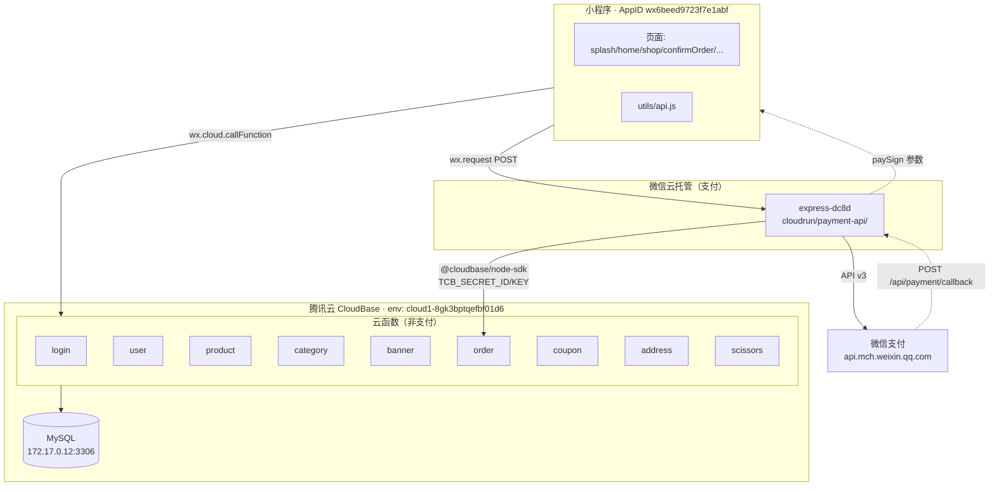
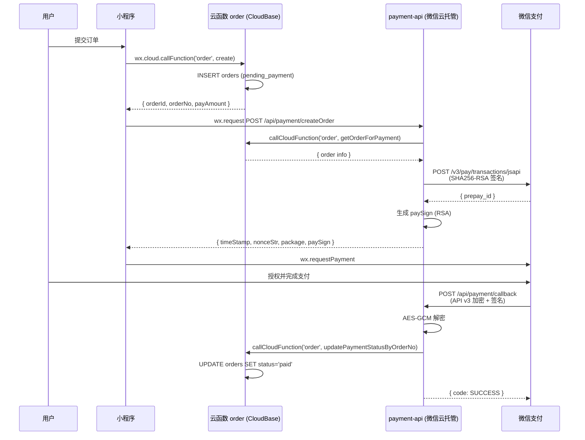

# Saven 小程序 · 架构说明

## 一、总览

Saven 小程序采用 **双平台混合架构**：

- **腾讯云 CloudBase**：承载非支付业务（登录、商品、订单、用户、优惠券、地址、剪刀等），数据存 MySQL
- **微信云托管**：仅承载支付业务（微信支付下单、回调、退款）

两者被迫分开的原因是 **CloudBase 云函数没有稳定公网出站**，无法可靠访问 `api.mch.weixin.qq.com`；而微信云托管容器有公网出站能力。



## 二、各业务调用路径

| 业务 | 小程序入口 | 服务 | 宿主 | 数据源 |
|------|-----------|------|------|--------|
| 登录 / 获取手机号 | `api.login()` | 云函数 login | CloudBase | MySQL users |
| 用户资料 / 积分 / 会员 | `api.getUserInfo / ...` | 云函数 user | CloudBase | MySQL users / points_logs |
| 首页 / 商品 / 详情 | `api.getHomeProducts / ...` | 云函数 product | CloudBase | MySQL products |
| 分类 | `api.getCategoryList / ...` | 云函数 category | CloudBase | MySQL categories |
| 轮播图 | `api.getBanners` | 云函数 banner | CloudBase | MySQL banners |
| 优惠券 | `api.getMyCoupons / ...` | 云函数 coupon | CloudBase | MySQL user_coupons |
| 收货地址 | `api.getAddressList / ...` | 云函数 address | CloudBase | MySQL addresses |
| 剪刀 / 保修 | `api.getMyScissors / ...` | 云函数 scissors | CloudBase | MySQL scissors |
| 订单列表 / 详情 / 创建 / 取消 | `api.getOrderList / createOrder / ...` | 云函数 order | CloudBase | MySQL orders |
| **支付下单** | `api.createPaymentOrder` | payment-api `/api/payment/createOrder` | **微信云托管** | 转发 order 云函数 |
| **支付回调** | （微信服务器发起） | payment-api `/api/payment/callback` | **微信云托管** | 转发 order 云函数 |
| **退款** | `api.refundOrder` | payment-api `/api/payment/refund` | **微信云托管** | 转发 order 云函数 |

## 三、支付完整流程



## 四、环境变量清单

### 微信云托管 · `express-dc8d`

| Key | 必填 | 说明 |
|-----|------|------|
| `PAY_APPID` | ✓ | 小程序 AppID |
| `PAY_MCH_ID` | ✓ | 商户号 |
| `PAY_API_V3_KEY` | ✓ | API v3 密钥（32 位） |
| `PAY_SERIAL_NO` | ✓ | 当前启用的商户证书序列号 |
| `PAY_PRIVATE_KEY` | ✓ | `apiclient_key.pem` 内容（单行 `\n` 或真换行均可） |
| `CALLBACK_URL` | ✓ | payment-api 公网 URL，不带尾斜杠 |
| `CLOUDBASE_ENV_ID` | ✓ | CloudBase 环境 ID（调云函数用） |
| `TCB_SECRET_ID` | ✓ | 腾讯云 API 密钥 ID |
| `TCB_SECRET_KEY` | ✓ | 腾讯云 API 密钥 Secret |

> **关键**：`PAY_SERIAL_NO` 和 `PAY_PRIVATE_KEY` 必须来自同一次证书申请，否则微信验签返回 `SIGN_ERROR`。

### CloudBase 云函数（所有业务函数）

| Key | 必填 | 说明 |
|-----|------|------|
| `ENV_ID` | 可选 | 默认 `cloud1-8gk3bptqefbf01d6` |
| `DB_HOST` | 可选 | 默认 `172.17.0.12` |
| `DB_PORT` | 可选 | 默认 `3306` |
| `DB_USER` | 可选 | 默认 `admin` |
| **`DB_PASSWORD`** | **✓** | **必须配置，不再写在源码里** |
| `DB_NAME` | 可选 | 默认 `cloud1-8gk3bptqefbf01d6` |

## 五、自检 / 诊断接口

| 接口 | 方法 | 用途 |
|-----|------|------|
| `/health` | GET | 存活检查 |
| `/health/pay-sign-check` | GET | 配置齐全性 + 私钥公钥指纹 + 时间同步状态 |
| `/health/sim-paysign` | POST | 模拟生成 paySign，排查 -1/签名错误 |

## 六、当前已知待办

- [ ] 小程序端把 `wx.request` 改为 `wx.cloud.callContainer`，可免合法域名白名单配置
- [ ] payment-api 的 `/api/payment/callback` 补齐 API v3 验签（下载平台证书 / 平台公钥 + 验 `Wechatpay-Signature` 头）
- [ ] 长期 `TCB_SECRET_ID/KEY` 改为 CAM 子账号 + 最小权限策略（仅 `callFunction`）
- [ ] 数据库密码 `DB_PASSWORD` 在所有云函数控制台补齐（已从源码移除，未配则连接失败）

## 七、安全 Checklist

- [x] `apiclient_*.pem` / `.p12` / `.key` 已加入 `.gitignore`
- [x] `1/` 目录（含真实私钥）已禁止提交
- [x] MySQL 密码从源码移除
- [x] `CONFIG-GUIDE.md` 去除明文示例私钥
- [x] 废弃的 `cloudfunctions/payment/` 已删除
- [ ] 若历史 commit 中曾经包含真实私钥或数据库密码，需要用 `git filter-repo` 清理并轮换凭证

## 八、目录结构

```
saven/
├── miniprogram/             小程序代码
│   ├── pages/              业务页面
│   ├── utils/api.js        统一 API 封装（callFunction + httpRequest）
│   └── app.json / app.js
├── cloudfunctions/         CloudBase 云函数（非支付业务）
│   ├── login/
│   ├── user/
│   ├── product/
│   ├── category/
│   ├── banner/
│   ├── order/
│   ├── coupon/
│   ├── address/
│   ├── scissors/
├── cloudrun/
│   └── payment-api/        微信云托管支付服务
│       ├── index.js
│       ├── package.json
│       └── Dockerfile
└── docs/
    ├── architecture.md     ← 本文件
    ├── database-design.md
    ├── technical-architecture.md
    └── cloudbase-deployment.md
```
