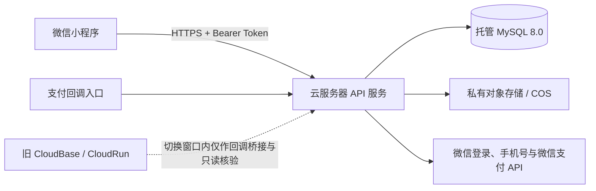

# CloudBase → 云服务器迁移执行计划（数据完整性与安全优先）

> **状态：待确认，尚未开始迁移。**  
> 本文件是后续迁移工作的唯一执行基线；每阶段完成后在第10节记录证据，并更新第16节放行表。第12–17节补齐最终探查和执行协议，具体切换按第13.4节执行。没有通过当前阶段的放行门槛，不得进入下一阶段。  
> 版本：v1.1 ｜ 更新日期：2026-09-05 ｜ 探查快照日期：2026-09-03。本文定义数据保护与验收条件，不构成零风险承诺；执行前须重查线上状态。

## 1. 结论与推荐路径

本项目不适合“一次性停掉 CloudBase 后再上线新服务器”。建议采用**先建新环境、完整演练、短时停写切换、保留旧环境作只读与支付回调桥接**的方式迁移。

推荐目标架构为：

其中，云服务器承载 API 和后台任务；**数据库建议使用托管 MySQL，图片使用私有对象存储**。不建议把 API、数据库、备份和商品图片全部放在一台服务器上：单机故障、磁盘损坏或误操作时，无法满足数据安全目标。

本次迁移的核心策略：

1. 先迁运行代码，再完成正式数据切换；不在订单、库存、积分和支付上做长期双写。
2. 数据库以最终“停写后的全量快照”为准，先进行至少一次全流程演练。
3. 云存储按原始对象清单复制、逐文件校验；不以临时 URL 作为迁移依据。
4. 微信支付旧回调地址在过渡期继续保留，通过受签名保护的桥接转发，避免历史订单回调丢失。
5. 新系统一旦开始接受生产写入，发生严重问题时进入维护和前向修复；**禁止直接把流量切回旧库**，避免形成两份各自有新增数据的“分叉数据库”。

## 2. 已知事实、合理推测与待确认项

### 2.1 已知事实（本地代码与 MCP 只读探查）

| 项目 | 探查结果 | 对迁移的影响 |
|---|---|---|
| CloudBase 环境 | `cloud1-8gk3bptqefbf01d6`，上海，状态正常，标准版预付费 | 旧环境必须保留至迁移稳定；当前套餐到期日为 2026-10-20，迁移排期不能依赖它无限期可用。 |
| 小程序后端代码 | 本地有 16 个云函数，约 6,766 行；`order` 2,224 行、`giftCard` 1,181 行 | 不能按“几个简单接口”估算；订单、积分、礼品卡须专项回归。 |
| 前端调用 | [miniprogram/utils/api.js](D:/saven/miniprogram/utils/api.js:61) 集中了 49 个云函数调用点 | 前端改造可集中进行，适合先做兼容 API 层。 |
| 身份体系 | [app.js](D:/saven/miniprogram/app.js:12) 初始化 CloudBase；[login/index.js](D:/saven/cloudfunctions/login/index.js:147) 依赖 `getWXContext().OPENID` | 迁出后必须用 `wx.login` 的 code 在服务端换取 OpenID，并建立服务端会话。 |
| 数据库 | CloudBase MySQL 实例运行中；实际发现 27 张表 | MySQL 可同引擎迁移，数据模型重建成本较低；但关系完整性仍需人工校验。 |
| 数据量 | 当前表规模较小，例如用户 36、订单 33、订单明细 33（`information_schema.TABLE_ROWS` 为估计值） | 适合采用“短时停写 + 最终全量导出”的安全策略；上线前仍须用精确 `COUNT(*)` 校验。 |
| 外键 | 当前库仅探测到 `coupon_rules → coupons` 一条外键 | 大部分关联没有数据库外键保护，迁移时必须做应用层关联完整性校验。 |
| 媒体 | CloudBase 存储桶为 `PRIVATE`，根目录已发现 208 个对象 | 不能把 CloudBase 临时链接直接存入新系统；应复制对象、保留私有访问和签名 URL。 |
| 支付服务 | `payment-api` 为一个公开的 CloudRun 容器，处理下单、支付回调、退款和物流上报 | 支付链路必须单独演练，且不能在切换期间中断历史订单回调。 |
| 线上/本地差异 | MCP 实际列出 30 个已部署云函数，本地目录仅 16 个 | 存在至少 14 个线上额外函数（包括 `admin-*`、`sf-express`、低代码和支付模板函数）；未盘点前不得下线 CloudBase。 |

### 2.2 合理推测

- 当前业务核心数据存于 MySQL；后续同轮 MCP 探查返回 NoSQL 集合数为 0，`scissors-admin` 的 NoSQL 代码属于待核实遗留入口，执行前须复查。
- 商品、积分商品、轮播和剪刀资料中可能保存 `cloud://` 文件标识；这些字段须在迁移时映射为新对象键或由新 API 动态签发访问地址。
- 实际支付金额、库存和积分属于高价值交易数据，迁移应优先控制一致性，而非追求零停机。

### 2.3 必须在执行前确认的信息

以下事项会改变实施细节，未确认前只允许准备和演练，不允许生产切换：

| 编号 | 待确认项 | 影响 |
|---|---|---|
| C-01 | 目标是否为“云服务器 + 托管 MySQL + COS”，或坚持数据库也部署在单台服务器 | 决定高可用、备份、网络和恢复设计。 |
| C-02 | 目标云厂商、地域、域名、备案状态和 HTTPS 证书 | 决定微信小程序 request 合法域名、支付回调域名与网络连通性。 |
| C-03 | 可接受维护窗口、业务低峰时段和支付待处理订单的处理规则 | 决定最终停写与支付排空策略。 |
| C-04 | 线上额外 14 个云函数的归属、是否仍在使用、是否需要迁移 | 避免遗漏后台、物流、运营或低代码能力。 |
| C-05 | 微信支付商户号权限、平台证书/公钥、回调域名修改权限和物流 API 权限 | 决定支付联调与回调连续性。 |
| C-06 | 数据保留期限、备份保存地点、谁有生产发布和删除权限 | 决定合规与灾难恢复责任。 |

## 3. 迁移范围与不在范围内的事项

### 3.1 本次必须迁移的能力

| 业务域 | 现有入口 | 迁移目标 | 风险等级 |
|---|---|---|---|
| 登录与手机号 | `login` 云函数 | 服务端微信 code 换 OpenID、手机号 code 解密、Token 会话 | 高 |
| 用户、会员、积分 | `user` | REST API + MySQL 事务 | 高 |
| 商品、分类、轮播 | `product`、`category`、`banner` | 兼容 API + 私有对象存储访问层 | 中 |
| 地址、优惠券 | `address`、`coupon` | 需从 Token 解析用户身份 | 高 |
| 剪刀与保修 | `scissors` | MySQL 事务、SN 唯一性与图片映射 | 高 |
| 普通订单、积分订单、售后 | `order` | 订单、库存、积分、退款全部服务端事务化 | 最高 |
| 礼品卡 | `giftCard` | 兑换幂等、商品礼品地址确认、记录完整性 | 高 |
| 支付、退款、回调、物流上报 | `paymentProxy` + `payment-api` | 独立支付模块，验签、幂等、回调桥接 | 最高 |
| 合作咨询 | `contact` | API、输入校验、反垃圾与访问控制 | 中 |
| 媒体文件 | CloudBase Storage | 私有 COS / 对象存储，清单、校验和映射表 | 高 |
| 运营后台及线上遗留函数 | 额外 `admin-*`、`sf-express`、低代码函数等 | 先盘点，再迁移或正式退役 | 高 |

### 3.2 本次不自动执行的事项

- 不自动购买云服务器、托管数据库、对象存储、域名、证书或续费 CloudBase。
- 不自动改微信公众平台合法域名、微信支付回调地址、商户配置或发布小程序版本。
- 不自动导出、复制、删除任何生产数据和生产文件。
- 不自动删除 CloudBase 环境、数据库、存储桶、云函数或历史日志。

上述动作需要业务负责人明确确认后才可执行。

## 4. 推荐目标架构与安全基线

### 4.1 目标部署建议

| 层级 | 推荐配置 | 数据安全要求 |
|---|---|---|
| API 服务 | 至少一台云服务器运行容器化 Node.js 服务，Nginx/Caddy 终止 TLS | 系统补丁、最小端口开放、非 root 运行、发布可回滚。 |
| 数据库 | 同地域托管 MySQL 8.0；若确需自建，必须有独立磁盘、自动备份、异机备份与恢复演练 | 仅 API 私网访问；启用自动备份、Binlog、加密传输和最小权限账号。 |
| 文件 | 私有 COS/对象存储，独立于服务器磁盘 | 保留对象键、版本/生命周期、校验和清单；仅 API 签发临时访问。 |
| 机密 | 云厂商密钥管理服务或受权限控制的运行环境变量 | 不写入仓库、镜像、日志或前端；迁移后轮换旧凭据。 |
| 入口与防护 | 已备案 HTTPS 域名、WAF/限流、访问日志 | 微信小程序合法域名和微信支付回调域名提前完成配置。 |
| 监控与备份 | API、数据库、支付回调、磁盘、错误率、业务对账告警 | 备份加密、异地/异账号保存，并完成恢复演练。 |

> 目标Node.js运行时执行前核查官方支持状态，选择仍受安全维护的兼容版本并在隔离环境验证；不能因源运行时较旧而原样部署已停止维护的版本。依赖升级与迁移分别留存测试证据。

### 4.2 身份与权限设计

1. 小程序调用 `wx.login()`，将临时 `code` 发给 `POST /api/v1/auth/session`。
2. 新服务端使用小程序 AppID/AppSecret 调微信接口换取 `openid` 和 `session_key`；AppSecret 仅存在于服务端机密管理中。
3. 服务端创建短期访问 Token 与可撤销刷新 Token；Token 的用户 ID 由服务端签发，客户端不可指定 OpenID。
4. `getPhoneNumber` 返回的 `code` 由服务端调用微信手机号接口校验并绑定；不把 `encryptedData`、`session_key` 或手机号写入日志。
5. 所有用户数据接口从 `Authorization: Bearer <token>` 解析用户，不再接受请求体中的 `openid`、`userId` 作为身份依据。
6. 管理后台采用独立管理员身份和权限模型，禁止以硬编码 OpenID 列表作为长期方案。

### 4.3 支付与回调设计

1. 创建支付前，新服务端以 Token 对应的用户和订单 ID 查询订单；客户端上传的金额、OpenID、订单状态均不可信。
2. 微信支付 API v3 私钥、APIv3 Key、商户号、平台证书/公钥均放入机密管理；不得复制到仓库、Docker 镜像或调试输出。
3. 支付与退款回调必须校验 `Wechatpay-*` 签名头、时间戳、Nonce、序列号，并进行 AES-GCM 解密；验签失败不得更新订单。
4. 以 `transaction_id`、`out_trade_no`、`out_refund_no` 等业务唯一键建立幂等记录。任何重复回调只返回成功确认，不得重复扣库存、加积分或退款。
5. 在最终切换前部署并验证“旧回调桥接”：旧 CloudRun 接到历史 `notify_url` 回调后，使用服务间签名转发至新服务；新服务照常验签和幂等处理。
6. 旧支付服务不能在切换当天直接删除。其保留期限以所有切换前的支付、退款、物流异步事件全部结束并完成对账为准。

## 5. 迁移前的盘点与基线工作

### 5.1 线上与本地差异盘点（硬门槛）

MCP 已确认线上有 30 个活动云函数，而本地仅有 16 个目录。以下远端函数或能力必须逐一处理：

- `admin-category`、`admin-inquiry`、`admin-stats`、`admin-banner`、`admin-scissors`、`admin-coupon`、`admin-user`、`admin-order`、`admin-product`
- `sf-express`
- `lowcode-datasource`、`lowcode-automation`、`lowcode-datasource-preview`、`lowcode-automation-preview`
- `wxpayFunctions`

执行人应建立一张《线上资源处置清单》，每项只能处于以下四种状态之一：

| 状态 | 含义 | 放行条件 |
|---|---|---|
| 迁移 | 新服务已有等价能力并完成测试 | 记录新模块、测试证据和负责人。 |
| 保留 | 过渡期仍必须运行在 CloudBase | 明确依赖、截止日期和监控。 |
| 退役 | 已确认无调用、无定时任务、无后台依赖 | 先保留代码和日志，再经审批停用。 |
| 待确认 | 无法确认用途 | 视为阻塞项，不得关闭旧环境。 |

### 5.2 数据基线清单

迁移演练和正式切换前，各执行一次以下只读采集，结果保存到受控的迁移证据目录，不写入 Git：

1. **数据库结构基线**：数据库版本、字符集、排序规则、时区、表、字段、主键、唯一键、索引、外键、触发器、视图、存储过程、事件。
2. **精确数据基线**：每张表执行 `COUNT(*)`；不可使用 `information_schema.TABLE_ROWS` 作为验收结论。
3. **关联完整性基线**：对订单/明细/地址、积分订单/明细、优惠券/领取记录、剪刀/绑定记录、礼品卡/兑换记录执行孤儿记录扫描。
4. **财务与库存基线**：按状态汇总普通订单、积分订单、退款申请、支付流水、库存、预留库存、积分余额与积分流水。
5. **媒体基线**：导出每个对象的原始 key、字节数、ETag、SHA-256、最后修改时间、引用表、引用字段、是否被业务记录引用。ETag 不一定是内容 MD5，不可替代完整内容哈希。
6. **运行基线**：云函数、CloudRun、合法域名、存储 ACL、数据库实例状态、支付回调地址、最近错误日志和当前待支付/退款数量。

### 5.3 备份策略（每次演练和正式迁移均执行）

| 备份对象 | 最低要求 | 验证方式 |
|---|---|---|
| MySQL 全量逻辑备份 | 使用一致性快照导出 schema、data、trigger、routine、event；加密后存至独立受控位置 | 在隔离 MySQL 实例完成一次真实恢复，确认可启动和可查询。 |
| MySQL 可恢复点 | 目标数据库启用自动备份和 Binlog；记录最终切换前的时间点/快照 ID | 在演练环境验证按时间点恢复流程。 |
| 对象存储 | 源对象清单 + 全量复制副本；保留原 bucket，不覆盖、不删除 | 全量比较key、size及内容SHA-256；ETag仅辅助，页面访问另做抽样验证。 |
| 源代码与配置 | 固定 Git commit/压缩归档、部署镜像摘要、依赖锁文件 | 从归档独立构建并运行健康检查。 |
| 机密 | 仅记录“已备份/已导入”的机密名称及版本号，不记录明文 | 用受权限控制的部署账户完成读取和连接测试。 |

**禁止事项：**

- 不能将数据库 dump、手机号、地址、支付回调原文、私钥或生产 `.env` 提交到 Git。
- 不能用“文件数量相同”代替对象内容校验。
- 不能用“应用能启动”代替数据库恢复演练。
- 不能在源库未冻结时把一次不完整的增量导入当作最终切换数据。

## 6. 分阶段实施计划

### 阶段 0：立项、边界与审批

**目标：** 固化目标架构、责任人、维护窗口和外部配置权限。

- [ ] 确认 C-01 至 C-06 的决策结果。
- [ ] 确认目标地域优先为上海，减少到现有数据库和微信服务的网络延迟。
- [ ] 确认迁移期间的用户提示文案、维护窗口、订单停写规则和客服处理口径。
- [ ] 指定生产发布负责人、数据库恢复负责人、支付负责人和业务验收负责人。
- [ ] 记录所有需要业务负责人确认的外部动作：购买资源、变更 DNS、变更微信平台配置、变更支付回调、发布小程序、进入维护模式、退役旧环境。

**放行门槛：** 有明确的目标资源方案、负责人、可接受停写窗口和回滚决策人。

### 阶段 1：完整盘点、源端备份与可恢复性验证

**目标：** 确认“要迁什么”，并证明任何一次迁移都能从源端恢复。

- [ ] 拉取线上 30 个函数的名称、运行时、触发器、调用量、最近日志和部署版本；逐项填入处置清单。
- [ ] 对 `sf-express`、所有 `admin-*`、低代码函数和 `wxpayFunctions` 确认调用方与业务负责人。
- [ ] 导出 MySQL schema，并与本地 [docs/database-design.md](D:/saven/docs/database-design.md:370)、`scripts/mysql/` 逐项比对；以线上 schema 为准。
- [ ] 对 27 张表生成精确行数、数据哈希、主键范围、唯一键冲突和孤儿记录报告。
- [ ] 建立订单、退款、积分、库存、礼品卡的切换前对账报表。
- [ ] 导出 CloudBase Storage 全量对象清单；将 208 个当前对象视为已发现下限，正式清单须支持分页且无截断。
- [ ] 找出所有 MySQL 字段中的 `cloud://`、CloudBase CDN URL、临时 URL 和富文本图片链接，形成“媒体引用映射表”。
- [ ] 完成一次源库逻辑备份和一次隔离恢复演练；备份校验通过后才允许创建迁移目标数据。

**放行门槛：** 线上额外函数全部有处置状态；源库/对象存储均有可验证备份；不存在未解释的关键数据源。

### 阶段 2：建立隔离的新生产环境

**目标：** 新环境具备安全、备份、日志和部署能力，但不接生产流量。

- [ ] 创建独立生产 VPC、API 云服务器、托管 MySQL、私有 COS bucket 和受限运维账户。
- [ ] 设置数据库仅允许 API 服务私网访问；禁止数据库公网暴露。
- [ ] 配置 HTTPS 证书、反向代理、健康检查、访问日志、错误告警、限流与基础 WAF 规则。
- [ ] 导入机密管理：小程序 AppSecret、微信支付密钥/私钥、数据库密码、服务间签名密钥。机密名称可入文档，明文不可入文档。
- [ ] 配置目标 MySQL 的自动备份、Binlog、慢查询、时间同步、字符集和时区；对恢复流程演练一次。
- [ ] 配置私有对象存储、服务器访问角色和最短必要权限的预签名下载/上传能力。
- [ ] 建立 Staging 环境或与生产隔离的预发布环境，禁止开发直接连接生产库调试。

**放行门槛：** 安全扫描、健康检查、数据库恢复、机密读取和对象存储签名访问均通过；新环境尚未接收用户生产写入。

### 阶段 3：后端兼容改造

**目标：** 把 CloudBase 云函数重构为普通 HTTP/API 服务，同时尽量保持前端返回结构稳定。

建议先以业务模块拆分，但第一版保留现有 `action` 的语义，降低小程序改动面：

| 原云函数 | 新模块建议 | 核心改造 |
|---|---|---|
| `login` | `auth` | `wx.login` code 换 OpenID、手机号 code 校验、Token 会话。 |
| `user` | `users` / `points` | 从 Token 获取用户；积分更新使用事务和流水。 |
| `product`、`category`、`banner` | `catalog` | 商品/分类/轮播查询与媒体 URL 适配。 |
| `address` | `addresses` | 所有 CRUD 强制加当前用户条件。 |
| `coupon` | `coupons` | 领取/核销使用唯一约束和事务。 |
| `scissors` | `warranty` | SN 绑定与保修状态在同一事务内完成。 |
| `order` | `orders` / `after-sales` | 库存、券、积分、订单、退款申请的事务边界保持不变或更严格。 |
| `giftCard` | `gift-cards` | 兑换码、兑换记录、地址确认、幂等键。 |
| `contact` | `inquiries` | 参数校验、频率限制、防滥用。 |
| `paymentProxy` + `payment-api` | `payments` | 认证、支付签名、回调验签、退款和物流上报。 |

具体要求：

- [ ] 将 `wx-server-sdk`、`cloud.getWXContext()`、`cloud.getTempFileURL()`、`@cloudbase/node-sdk` 调用替换为标准 SDK 或内部模块。
- [ ] 为每个模块建立输入校验、错误码、审计日志和请求 ID；日志须脱敏手机号、地址、OpenID、支付密钥和回调密文。
- [ ] 保留或显式迁移订单、积分、库存、礼品卡中已有的事务、行锁、幂等键与唯一约束。
- [ ] 新建内部服务认证；支付模块调用订单模块不得依赖公开 HTTP 端点或客户端传来的 OpenID。
- [ ] 完成 API 合约测试：新旧接口在同一组脱敏测试数据下的状态码、字段类型、金额精度、分页和错误码一致。

**特别说明：** [miniprogram/utils/api.js](D:/saven/miniprogram/utils/api.js:81) 的 `wx.cloud.callFunction` 可统一替换为 `wx.request` 封装；[app.js](D:/saven/miniprogram/app.js:52) 的自动 CloudBase 登录需要替换为新会话刷新流程。不得在小程序中保留 AppSecret、数据库密码或支付机密。

**放行门槛：** 核心模块在预发布库通过单元、集成和接口合约测试；支付回调验签、重复回调和用户越权测试均通过。

### 阶段 4：媒体迁移与 URL 兼容

**目标：** 迁走文件但不破坏商品图、轮播图、规格图、剪刀卡片和富文本详情。

1. 以源 bucket 的对象清单为唯一输入，复制到新 COS 的隔离前缀，例如 `migration/<batch-id>/`。
2. 复制后比较 key、size 和源/目标实际内容 SHA-256；ETag 只作辅助元数据。任一不一致时标记失败，不得删除源对象。
3. 建立 `media_asset_map`（或等价表），至少记录：`source_object_key`、`source_file_id`、`target_object_key`、`size`、`checksum`、`migration_batch`、`verified_at`、`reference_status`。
4. 新 API 只返回新域名下的短期签名 URL 或受控图片代理 URL；不得将永久可访问的私有桶地址暴露给客户端。
5. 对数据库字段和富文本中的旧媒体链接执行**报告 → 试转换 → 抽样复核 → 批次发布**，禁止无备份的全库字符串替换。
6. 原 CloudBase Storage 的 ACL 当前为 `PRIVATE`，目标存储必须保持同等级或更严格的访问控制。

**验收方式：** 全量对象数、总字节数、逐文件校验和、被引用文件可打开率、未被引用“孤儿文件”清单、随机抽样商品详情页截图比对。

### 阶段 5：数据库迁移演练

**目标：** 在不影响生产的情况下，至少完成一次“源库 → 新库 → 验证 → 恢复”闭环。

推荐策略为**全量演练 + 最终短时停写全量快照**。原因是当前业务数据规模小，而订单、库存、积分、礼品卡和退款的长期双写容易制造难以发现的不一致。

#### 5.1 演练步骤

- [ ] 在隔离环境建立与源库等价的 MySQL schema；保留主键、唯一键、索引、默认值、字符集、排序规则、触发器、事件和自增起点。
- [ ] 使用一致性快照导出源库并导入演练库；不要将数据导出到未加密的个人电脑目录。
- [ ] 执行全表精确行数比对；逐表比较规范化数据哈希，异常表逐主键定位。
- [ ] 检查每张表 `AUTO_INCREMENT` 不小于当前最大主键加一。
- [ ] 执行孤儿数据检查：订单与订单明细/地址、积分订单与明细、优惠券模板与用户券、剪刀与用户绑定、礼品卡与兑换记录。
- [ ] 执行业务对账：订单状态金额汇总、退款金额、库存与预留库存、积分余额与流水净额、礼品卡余额/兑换状态。
- [ ] 在演练库运行新 API 的读写回归；回滚演练库并再次恢复，证明备份可用。

#### 5.2 数据迁移验收规则

| 类别 | 必须满足的条件 |
|---|---|
| 结构 | 目标 schema 与审批后的源 schema 完全一致，或每项差异有审批记录。 |
| 行数 | 所有业务表精确 `COUNT(*)` 一致；不接受估计值。 |
| 主键和唯一键 | 无重复、无主键缺失，目标自增值安全。 |
| 关联 | 所有关键关联孤儿数为 0；历史例外须有明确业务签字。 |
| 金额 | 按订单状态、支付状态、退款状态汇总的金额完全一致。 |
| 积分 | 用户余额、积分流水、积分订单和支付日志的对账规则通过。 |
| 库存 | 商品/积分商品库存、预留库存、销量和相关订单关系通过既定对账规则。 |
| 文件 | 每个业务引用对象可访问，且目标内容校验通过。 |

**放行门槛：** 至少一次演练无 P0/P1 差异；恢复演练成功；所有差异均有书面解释和负责人确认。

### 阶段 6：灰度、影子验证与支付桥接

**目标：** 在正式切换前，证明新系统对真实流量模式是安全的。

- [ ] 生产只读请求可在授权范围内进行影子验证：新旧系统使用同一份脱敏或受控生产快照，比对商品、订单列表、订单详情、积分和保修返回值。
- [ ] 禁止对订单创建、取消、库存扣减、积分兑换、领券、礼品卡兑换、支付和退款做无控制的生产双写。
- [ ] 为新 API 建立灰度开关，先限内部测试账号；用户身份、订单和支付数据不允许跨库混用。
- [ ] 部署旧 CloudRun 到新服务的回调桥接，服务间采用 HMAC/mTLS 等签名认证，并演练：正常支付回调、重复回调、乱序回调、退款回调、桥接重试失败。
- [ ] 先用隔离库和模拟签名事件做测试；核查实际可用的微信测试能力。真实扣款、退款或物流下单仅在业务明确批准金额、账户、范围后执行，不能假定存在可用沙箱。
- [ ] 在微信开发者工具和真机验证小程序的新 request 合法域名、TLS、Token 刷新、手机号授权和异常提示。

**放行门槛：** 新旧读接口比对通过；支付桥接和幂等验证通过；小程序审核/发布路径和合法域名已准备好。

### 阶段 7：正式切换运行手册

#### 7.1 切换前 7 天至 1 天

- [ ] 完成最终演练报告并由技术与业务负责人签字确认。
- [ ] 检查 CloudBase 到期时间是否覆盖过渡期；如需续费属于付费操作，先获得确认。
- [ ] 确认目标域名备案、HTTPS、微信公众平台 request 合法域名、微信支付回调配置和 DNS TTL。
- [ ] 确认所有待支付订单、退款中订单、库存异常、积分异常和礼品卡异常的处置规则。
- [ ] 建立切换群组、值守名单、升级路径和维护公告；不得在切换时临时决定资金类规则。

#### 7.2 切换窗口内的严格顺序

1. **宣布维护并停止新写入。** 停止下单、积分兑换、领券、礼品卡兑换、地址写入、后台编辑、退款发起等写操作；支付入口同时停止创建新的支付单。
2. **处理在途交易。** 清点 `pending_payment`、`refunding`、待回调和待物流上报记录，按照已确认的业务规则排空、取消或纳入回调桥接队列。未处理完的资金交易不得静默忽略。
3. **生成最终源端快照。** 在写入冻结后依次完成数据库一致性导出、精确行数/哈希报告和最终对象清单；记录时间点和文件哈希。
4. **导入目标库并执行最终校验。** 使用与演练相同的脚本，校验 schema、行数、哈希、关联、金额、积分、库存和媒体映射。
5. **启用新服务写能力。** 先以内部账号完成登录、商品、订单、支付、退款、图片访问的冒烟测试；通过后才允许灰度用户进入。
6. **切换小程序 API。** 通过审批后的版本/配置将 [api.js](D:/saven/miniprogram/utils/api.js:81) 的请求入口切至新 HTTPS 域名；旧小程序版本仍可能调用 CloudBase，须保留旧服务直至版本覆盖和过渡完成。
7. **保持旧回调桥接。** 对切换前生成的支付单，旧 `notify_url` 仍可能收到回调；桥接应持续运行并记录每次转发和目标幂等处理结果。
8. **观测 30–60 分钟后扩大灰度。** 观察错误率、登录成功率、订单创建、支付回调、库存、积分和媒体访问；任何 P0/P1 问题立即停止扩大流量。

#### 7.3 回滚与前向恢复规则

| 场景 | 允许的动作 | 禁止的动作 |
|---|---|---|
| 新服务尚未接受生产写入 | 可把流量/配置切回旧服务，源库保持为唯一写入源 | 不得删除目标库或覆盖源备份。 |
| 新服务已接受生产写入但未发生资金交易 | 立即维护、冻结目标写入、评估前向修复或受控反向迁移 | 不得直接把用户流量切回旧库。 |
| 新服务已接受订单、支付、退款、积分或库存写入 | 以目标库为事实来源，进入维护和前向修复；保留回调桥接与所有审计记录 | 严禁盲目恢复旧库、删订单或重新执行支付。 |
| 发现数据校验不一致 | 停止灰度扩大，保留证据，按主键定位并用审批后的修复脚本处理 | 不得用手工修改金额、积分或库存来“凑平”。 |

**核心原则：** 数据安全优先于快速恢复。生产写入开始后，回滚不是“切回旧地址”，而是一个有对账、备份和审批的独立数据迁移动作。

### 阶段 8：稳定观察、对账与旧资源退役

- [ ] 切换后按小时观察 API 错误、授权失败、支付回调验签失败、订单/退款状态滞留、图片访问失败和数据库连接异常。
- [ ] 每日完成资金、订单、库存、积分、礼品卡和媒体访问对账；记录异常、处理人和关闭证据。
- [ ] 保持 CloudBase、CloudRun、MySQL 和 Storage 只读/桥接状态，直至业务负责人确认过渡期完成。
- [ ] 只有在所有远端函数处置完成、旧版本小程序覆盖达到业务认可阈值、历史回调窗口结束、备份恢复演练通过后，才可申请停用旧资源。
- [ ] 删除或停用旧资源前，再执行一份最终备份并验证可恢复；删除操作必须单独获得明确确认。
- [ ] 切换稳定后轮换 CloudBase 数据库密码、腾讯云 API 密钥、微信支付相关机密和服务间签名密钥，并审计旧权限。

## 7. 风险登记册与应对措施

| ID | 风险 | 当前证据 | 影响 | 应对措施 | 触发后的处置 |
|---|---|---|---|---|---|
| R-01 | 线上函数与本地代码不一致 | 线上 30 个函数，本地 16 个 | 遗漏后台、物流或自动化能力 | 完成逐项处置清单和调用/触发器检查 | 阻止旧环境退役与正式全迁。 |
| R-02 | 关联数据缺少外键保护 | 仅发现一条外键 | 迁移后可能有孤儿订单明细、券或绑定记录 | 导入前后执行关联扫描；关键约束在目标库补齐或用事务保护 | 停止切换，定位主键后修复并重跑校验。 |
| R-03 | 私有云存储迁移后图片失效 | Storage ACL 为 PRIVATE，代码调用临时 URL | 商品详情、轮播、剪刀卡片不可访问或误公开 | 对象清单+哈希、媒体映射表、签名 URL 验证 | 保持源存储可读，回退到媒体适配层，不删除源对象。 |
| R-04 | 客户端伪造 OpenID/金额 | 现有支付 HTTP 层有传入 OpenID 的路径 | 越权下单、查询或资金风险 | Token 解析用户、服务端查询金额、订单所有权校验 | 立即下线受影响接口，旋转 Token/密钥，审计订单。 |
| R-05 | 微信支付回调丢失或重复 | 旧/新回调地址并存，异步重试可能发生 | 订单未支付、重复积分/退款 | 验签、幂等表、旧回调桥接、在途订单排空 | 暂停写入，按支付平台账单和回调日志对账后前向修复。 |
| R-06 | 切换后双库分叉 | 新旧系统同时接受写入 | 数据不可判定、人工对账成本高 | 最终停写快照；核心交易不双写；明确回滚规则 | 维护模式，选择单一事实库，执行受控反向迁移。 |
| R-07 | 订单、库存、积分事务行为改变 | `order` 代码复杂且业务耦合 | 超卖、积分负数、券重复使用 | 保留事务/行锁/唯一键；高并发和重复请求测试 | 停止相关功能，冻结异常商品/订单，审计并修复。 |
| R-08 | 域名、备案或 TLS 未完成 | 新服务器需小程序合法域名和支付回调域名 | 小程序请求失败、回调无法到达 | 切换前完成真机 HTTPS 与合法域名验证 | 不切换；保持旧入口。 |
| R-09 | 机密泄露 | 有支付私钥、AppSecret、数据库凭据 | 账户、支付和用户数据安全事件 | 机密管理、最小权限、脱敏日志、迁后轮换 | 立即轮换、撤销、审计并按事件流程处理。 |
| R-10 | 源环境到期或被过早删除 | CloudBase 套餐有到期日 | 无法回查、回调丢失、无法恢复 | 迁移排期覆盖过渡期；停用需审批 | 必要时先续费（需确认），不进行删除。 |
| R-11 | 单台服务器故障 | 若数据库与 API 同机部署 | 全站不可用或数据损坏 | 推荐托管 DB、COS、异机备份和恢复演练 | 从备份/PITR 恢复，按灾备预案复盘。 |
| R-12 | 遗留NoSQL入口与后续新增数据遗漏 | 代码使用cloud.database()，同轮探查集合数为0 | 后续可能写入不同数据源 | 切换前复查集合、调用方；有数据则纳入备份，空集合也要处理遗留入口 | 发现新集合即更新迁移范围。 |

## 8. 验收标准（必须全部满足）

以下条件采用可验证表述，任何一项未通过即为不放行：

1. 当最终源库冻结完成时，目标数据库应具有与源库一致的经审批 schema、精确行数、主键/唯一键和数据校验结果。
2. 当订单、退款、积分、库存和礼品卡对账执行时，新旧系统的汇总结果应一致；任何例外都应有订单/记录级别的说明和业务负责人确认。
3. 当目标对象存储复制完成时，每个源对象应在迁移清单中有唯一目标映射，并且 size 与哈希校验通过。
4. 当登录、手机号授权、用户地址、订单和保修接口收到请求时，新服务应仅使用服务端会话识别用户，而不应信任客户端传入的 OpenID 或 userId。
5. 当微信支付或退款回调重复、延迟或乱序到达时，系统应完成验签并保持幂等，不应重复变更订单、库存、积分或退款金额。
6. 当新服务刚开始接收生产写入时，旧系统应停止核心写入；任何恢复动作不应导致两套数据库同时成为写入源。
7. 当单个服务、数据库或对象存储凭据泄露/失效时，运维人员应能依据机密清单完成撤销、轮换和恢复，且机密明文不出现在仓库或日志中。
8. 当迁移失败发生在目标库接收写入之前时，应能在维护窗口内恢复旧入口；当迁移失败发生在目标库接收写入之后时，应进入前向修复流程，不得盲目切回旧库。

## 9. 后续执行任务清单

> 状态约定：`[ ] 未开始`、`[-] 进行中`、`[x] 已完成`、`[!] 阻塞`。实际执行时必须填写负责人、日期、证据链接和审批人。

### A. 决策与资源

- [ ] A-01 确认目标架构采用“云服务器 API + 托管 MySQL + 私有 COS”。
- [ ] A-02 确认目标云厂商、地域、域名、备案和证书方案。
- [ ] A-03 确认维护窗口、在途支付处理规则和业务验收负责人。
- [ ] A-04 获得创建/购买生产资源的明确授权。

### B. 线上盘点与备份

- [ ] B-01 导出线上 30 个云函数详情、触发器和调用关系。
- [ ] B-02 完成线上额外函数处置清单并获业务负责人确认。
- [ ] B-03 导出并审计 MySQL schema、索引、触发器、事件和数据精确基线。
- [ ] B-04 生成完整对象存储清单与业务引用映射。
- [ ] B-05 制作加密数据库备份、对象备份和代码/镜像归档。
- [ ] B-06 在隔离环境完成数据库和对象备份恢复演练。

### C. 新环境与安全

- [ ] C-01 建立网络、服务器、托管数据库、私有对象存储和监控。
- [ ] C-02 配置数据库私网访问、自动备份、Binlog、PITR 和恢复演练。
- [ ] C-03 配置 TLS、WAF/限流、日志脱敏、告警和审计。
- [ ] C-04 导入机密管理并配置最小权限服务账号。

### D. 代码和接口迁移

- [ ] D-01 建立兼容 API 骨架、统一错误码、请求 ID 和健康检查。
- [ ] D-02 迁移 `auth/login`，完成微信 code、手机号 code、Token 和越权测试。
- [ ] D-03 迁移商品、分类、轮播和媒体访问适配。
- [ ] D-04 迁移用户、地址、优惠券、剪刀、礼品卡业务模块。
- [ ] D-05 迁移订单、积分、库存、售后与退款申请，并完成并发/幂等测试。
- [ ] D-06 迁移支付、退款、回调和物流上报，并完成 API v3 验签测试。
- [ ] D-07 改造小程序 `api.js` 和 `app.js`，完成真机回归。
- [ ] D-08 处理所有线上额外函数：迁移、保留、退役或确认阻塞。

### E. 演练、切换与稳定期

- [ ] E-01 完成一次全量数据库与对象存储迁移演练。
- [ ] E-02 完成新旧接口合约、订单/积分/支付、媒体和权限回归测试。
- [ ] E-03 部署和验证支付回调桥接。
- [ ] E-04 获得正式切换、微信平台配置变更和小程序发布授权。
- [ ] E-05 执行维护、最终停写快照、目标校验、灰度切换和实时监控。
- [ ] E-06 完成每日对账、稳定期验收和旧资源处置申请。

## 10. 执行记录模板

后续每次操作必须在本节追加，不覆盖历史记录：

| 日期时间 | 阶段/任务 | 执行人 | 操作摘要 | 数据/版本证据 | 校验结果 | 审批人 | 状态 |
|---|---|---|---|---|---|---|---|
| 待填写 |  |  |  |  |  |  |  |

## 11. 本计划的证据来源

- 本地架构说明：[docs/architecture.md](D:/saven/docs/architecture.md:1)
- 小程序统一接口层：[miniprogram/utils/api.js](D:/saven/miniprogram/utils/api.js:1)
- CloudBase 初始化与自动登录：[miniprogram/app.js](D:/saven/miniprogram/app.js:1)
- 登录云函数：[cloudfunctions/login/index.js](D:/saven/cloudfunctions/login/index.js:147)
- 订单云函数：[cloudfunctions/order/index.js](D:/saven/cloudfunctions/order/index.js:1)
- 支付服务：[cloudrun/payment-api/index.js](D:/saven/cloudrun/payment-api/index.js:464)
- 数据库设计：[docs/database-design.md](D:/saven/docs/database-design.md:370)
- 现有积分上线检查：[docs/points-system-go-live-checklist.md](D:/saven/docs/points-system-go-live-checklist.md:1)
- CloudBase MCP 只读探查：环境信息、云函数列表、CloudRun 列表、MySQL 实例/表清单、存储权限/对象清单（2026-09-03）。

---

**下一步：** 先完成本计划中的 A-01 至 A-04 和 B-01 至 B-06；在你明确确认目标资源方案和维护窗口前，不进行任何生产资源创建、数据导出、支付配置变更或上线操作。

## 12. 补充核验结果及执行优先级（2026-09-05 整理）

本节至第 17 节补齐前述阶段的执行条件，若与早期概括不一致，以本节之后的具体条件为准。下述线上数字来自 2026-09-03 的同轮 MCP Sravx 只读探查及并行复核，并非 2026-09-05 的实时状态；执行前重新采集。探查不等于完成备份、修复或验收。

### 12.1 已确认快照与例外

| 编号 | 探查事实 | 执行约束/关闭证据 |
|---|---|---|
| EX-01 | 精确计数 users=50，orders/order_items/order_addresses 各45，products=11，scissors=14，points_orders=3，points_payment_logs=4，gift_cards=10，gift_redeem_records=8 | 第2节的36用户、33订单为估计值，不能作基线。全部27表冻结后重新精确计数和逐块哈希。 |
| EX-02 | 2笔积分待支付，现金合计24元、积分1398；2笔普通订单退款中、2笔退款申请已批准 | 逐笔核对平台状态、库存/积分占用、退款申请与退款号；可重叠，不能相加当作不同订单数。不自动取消、退款或返还积分。 |
| EX-03 | 4笔已付款相关状态订单缺 pay_transaction_id | 由业务核对微信交易、人工单/零元单等来源；未核实不补造交易号。 |
| EX-04 | 5条 bound 剪刀缺商品父记录；5条 bound 剪刀无 user_scissors；3条 user_scissors 对应剪刀仍为 unused | 这些集合可能重叠。原样备份和复制；人工确认映射/状态或批准安全降级的历史例外，不能按名称、图片猜测归属。 |
| EX-05 | users.points 合计61040、total_points 合计62438；points_logs仅5条、净+1739；points_payment_logs仅4条、净-1398 | 历史流水不能完整反算余额。迁移验收比较源目标相同值及相同历史差异；不重算、不归零、不补发积分。新交易必须新增完整账本。 |
| EX-06 | 源库混用 utf8mb4_unicode_ci / utf8mb4_0900_ai_ci；仅一个物理外键 coupon_rules→coupons | 初迁逐表保留排序规则；目标须验证兼容性。关联校验显式处理 collation；不得趁迁移统一转换。 |
| EX-07 | NoSQL 集合数为0；线上仍有遗留 scissors-admin | 再查集合及调用方，零集合不等于函数可直接删除；新增集合自动纳入范围。 |
| EX-08 | 私有动态桶208对象，294903260字节；含44个draft对象 | 全量复制包含草稿和中文路径，禁止按未发布删除。正式验收使用冻结时重新分页枚举的数量。 |
| EX-09 | 静态托管另外531对象，含adminportal/、assets/、__auth/；本地未发现后台Web源码 | 取得后台源码或经过验证的发布制品及构建方法。全量归档；CloudBase __auth/不能复制后充当新认证服务。 |

### 12.2 完整数据库范围（27表，空表也必须保留）

| 业务域 | 表 |
|---|---|
| 用户与地址 | users、addresses、user_addresses |
| 商品与媒体配置 | products、product_specs、categories、banners |
| 普通订单与售后 | orders、order_items、order_addresses、order_refund_requests |
| 积分商品与订单 | points_categories、points_products、points_product_specs、points_orders、points_order_items、points_order_refund_requests、points_payment_logs、points_logs |
| 优惠券 | coupons、coupon_rules、user_coupons |
| 礼品卡 | gift_cards、gift_redeem_records |
| 剪刀与合作 | scissors、user_scissors、cooperation_inquiries |

每次执行重新查询线上表清单；新增表纳入，消失表查明原因。addresses 与 user_addresses 均保留，迁移期不合并。完整导出线上 SHOW CREATE TABLE 等结构，不能用本地旧SQL拼装生产库。scripts/mysql/points_system_rollback.sql 含删表操作，禁止把它当本次迁移回滚脚本。

### 12.3 上线前的安全改造验收

- 本地 paymentProxy 转发未见服务签名；payment-api 公开访问，order 的多个内部支付/退款/发货动作未见完整调用方校验。属于源码和暴露配置支持的高风险发现，尚未进行攻击验证，不宣称线上已被利用。禁止迁移时原样公开所有 action。
- 区分三类入口：用户Token保护的业务API；管理员RBAC和审计保护的后台API；不需要用户Token但必须验证微信签名的回调API。内部状态写入用进程内方法或受强认证的服务接口。
- 退款审核不能延用前端共享 adminSecret。用户仅提交申请，审批和执行由有权限的后台流程完成；任何实际退款仍按业务权限确认。
- 运行期建表/加列从 order、giftCard 移到编号migration；应用账号移除DDL权限。普通订单创建须重新检查优惠券、积分、库存和订单是否整体在同一事务，不能因局部出现 FOR UPDATE 就判定全部原子。
- 建立支付尝试、通知入站、退款与业务事件账本。验证交易号、退款号、请求幂等键唯一约束；points_orders 缺少预期的幂等索引，不能仅靠先查后写防重。
- 新约束先在恢复库检查历史NULL、空字符串、重复值和字段兼容性；任何历史数据修复独立记录、审批。不得强加索引导致生产业务中断。
- 登录用静默code交换，保留小程序AppID与原用户主键；登录code与手机号code使用不同字段。迁移旧用户数据但不把客户端缓存或旧CloudBase会话当新Token。
- 手机号原始解密响应、Token、session_key、地址及支付密钥不输出日志。手机号字段加密如引入，应单独设计可逆迁移及查找兼容，不能切库时临时改变字段含义。
- 超时关单改为有执行锁、监控和幂等的任务，先核对微信支付状态；处理关单后到账和关单/付款并发，不得释放资产后遗漏实际收款。

## 13. 冻结、回调和旧客户端的执行协议

### 13.1 路线选择与恢复目标

默认路线：隔离副本完成代码验证 → 发布兼容入口和回调持久化能力 → 关闭所有业务写入 → 最终全量快照迁库 → 校验 → 切换单一写库 → 恢复业务。

先共用源MySQL迁计算是可选降低风险方案，仅在私网可达、独立最小权限账号、兼容schema和单一业务写处理器均验证后采用；同地域不代表必然能访问源库私网。同库灰度也不能让两个消费者重复处理同一付款。CDC仅在全量恢复时间超过批准维护窗口时评估，需验证权限、日志保留、GTID/位置和删改同步；本项目当前体量不默认引入CDC。

迁移目标RPO=0，含所有已经确认接收的业务写入及支付通知；这是要以证据证明的目标，并非无条件保证。拟定业务停写预算60分钟、切换前回切目标30分钟，均须经演练和业务批准后才成为正式承诺。恢复演练超过预算则延长窗口或改方案，不降低校验标准。

### 13.2 回调入站必须独立于待迁业务库

1. 在冻结之前，旧、新回调入口保留原始HTTP body和微信签名头，在接收时按官方规则验签；禁止重新序列化JSON破坏原始签名。
2. 将已验证事件写入独立持久化队列/入站存储（不在本次停写数据库上），加密、权限隔离、事件唯一键、收到时间、内容摘要、处理状态齐全。确认持久化成功才返回符合微信协议的成功响应；无法持久化返回失败，让平台重试并告警。不能只存进程内存。
3. 正常期单一消费者写当前事实库；冻结期暂停消费者，接收器继续收取。停止旧消费者并等待所有正在执行的事务结束，记录业务库水位和队列已提交消费水位。
4. 业务提交后才标记事件已处理。提交后宕机、标记前宕机应允许重放并由目标数据库唯一约束去重。已在源库提交的通知去重记录随库完整迁移。
5. 最终快照之后新到的事件只在队列中，不能继续改源业务库。迁库校验通过、目标确定为唯一事实库后，才启动目标消费者从记录水位继续消费。
6. 延迟重放不把旧微信时间戳伪造为当前时间。使用接收时验签成功的可信凭据、内容摘要和内部签名；审计原始事件，复核商户、AppID、订单、金额和交易唯一性。
7. 微信回调重试能力不能替代自有持久化。队列故障、无法确认水位或持续丢失通知时，禁止进入冻结/切库。

### 13.3 完整写入围栏

停止写入必须覆盖：旧版/新版小程序、CloudBase函数、后台静态站、管理员工具、低代码、物流同步、定时任务、补偿消费者、上传/删除接口，以及会更新last_login_at或执行DDL的所谓读取接口。

实施时先在应用层维护开关拒绝业务写入，再停止任务/排空事务，最后用经过演练的账号撤权或数据库写入围栏保证源库不再写。数据库操作由有权限人员执行；核验活跃连接、未提交事务、Binlog位置或等价写审计连续稳定。没有覆盖全部写入口的证据不能导出最终快照。

旧小程序不能靠改DNS更新 wx.cloud.callFunction。切库前必须部署向后兼容的旧函数：仅验证真实CloudBase身份、按白名单动作转发到唯一新服务并带服务签名；禁用旧SQL/DDL写路径。无法安全桥接的旧版本显示维护/更新提示；禁止仍写旧库。后台同样改新API或保持维护。

兼容桥和直接新API共用幂等存储；写请求超时先查原请求状态，不自动换后端重发。真实用户路由与支付回调路由分别记录，不因小程序灰度比例而把同一订单发给两个数据库。

### 13.4 最终切换检查卡（替代第7.2节的概括顺序）

| 步骤 | 操作者角色 | 动作与必须保留的证据 | 不通过时 |
|---|---|---|---|
| T0 | 业务负责人 | 维护窗口、预算、例外、测试交易范围批准 | 不开始 |
| T1 | 支付/运维 | 回调入站持久化和重放演练通过；记录队列健康 | 保持源运行 |
| T2 | 后端/数据库 | 停所有业务写、暂停消费者、排空事务、冻结上传与后台；验证源写水位稳定 | 撤销维护前先恢复原消费者并对账 |
| T3 | 数据库/文件 | 源最终schema、全量数据、精确清单、哈希、队列水位、对象版本、备份摘要 | 目标保持隔离 |
| T4 | 数据库 | 恢复目标，逐表哈希/计数，允许的结构变更按批准清单单独执行并复核 | 回切源，不写目标 |
| T5 | 验收负责人 | 只读对账通过、例外与源一致、对象完整；批准提交点 | 保持维护 |
| T6 | 运维/支付 | 记录提交点和唯一目标库；启动目标消费者、重放积压并核验 | 已有目标提交即按前向恢复 |
| T7 | 后端/业务 | 开放内部白名单写入、执行获批测试，再逐步开放新旧兼容入口 | 暂停新增交易，保留入站 |
| T8 | 业务/运维 | 队列积压清零、支付逐单一致、无新增资产差异后结束维护 | 延长维护并报告 |

注意：恢复消费者产生的第一笔目标库提交也算生产写入，早于用户开放。内部测试下单也计入，不得说“尚未全量上线，可以直接回旧库”。

## 14. 校验工具、证据产物与故障演练

### 14.1 下一阶段需实现的工具（本次仅规划，尚未生成或运行）

| 工具 | 输入与输出 | 验收要求 |
|---|---|---|
| inventory | 线上资源/表/对象 → 脱敏资源矩阵、分页完成标记 | 发现新增资源即阻断范围封板 |
| schema-export | 源DDL、索引、时区、sql_mode、collation → schema清单 | 保留原DDL和批准差异；不输出凭据 |
| row-check | 同一冻结源及目标 → 每表计数、主键范围、分块SHA-256 | 全表全行覆盖；差异仅输出受控主键或哈希 |
| business-check | 订单、资产、绑定 → 汇总和例外差异报告 | 历史例外原样保留；新增差异=0 |
| asset-copy-check | 完整key/版本清单 → 复制/失败/重试/内容哈希映射 | 中断可续传，零漏页，中文/草稿/同名无覆盖 |
| callback-replay | 已验证事件 → 单次与重复消费结果 | 任意重试只产生一次有效业务变化 |
| freeze-check | 全写入者清单、事务与消费状态 → 冻结证据 | 每个写入口有禁止写证据，非只关闭UI |

行哈希规则：固定列顺序与主键顺序、显式区分NULL/空串、长度前缀编码，DECIMAL用精确字符串，BIGINT不经过JavaScript浮点数，二进制用原字节、JSON规范化、时间固定精度及语义。源/目标使用同一版本工具；无主键表按稳定全行多重集校验。不能用GROUP_CONCAT生成可能截断的全表哈希。

结构新增账本/会话表和媒体引用转换单独登记；先验证原始恢复完全一致，再执行转换，保存转换前后映射和可逆性报告。不要拿已转换目标与未转换源直接比哈希。

### 14.2 必须交付的证据

每个migration_batch保留：源/目标资源ID、代码与镜像摘要、manifest及哈希、加密备份位置、恢复耗时、schema-diff、row-check、business-check、asset-map、冻结记录、队列水位、发布配置、异常清单和签字。生产原文放独立受控存储，Markdown只放摘要和受控引用，不存姓名、电话、地址、订单号、兑换码或密钥。

现有源码不等于线上部署代码。必须取得30个函数当前制品及配置名称清单并比较哈希；线上独有代码先受控归档，排除密钥后才进入开发仓库。函数返回的原始环境变量和临时下载链接不粘入报告。

### 14.3 必测故障

- 复制中断后恢复：目标不缺行、不重行、不覆盖同名不同路径文件。
- 付款回调在冻结前、冻结中、快照后及切换后到达：全部有持久化记录和一次性处理证据。
- 数据库已提交但消费者未确认就宕机：重放不重复加积分、扣库存或退款。
- 用户双击、网络超时、旧版桥接与新版并发：同一业务幂等键复用，跨用户不能盗用幂等结果。
- 微信签名错误、商户/AppID错误、金额不符、未知订单、关单后到账、退款乱序：告警并进入已定义异常流程。
- 目标库不可用、队列不可用、媒体签名失效、Token过期：保护已接收数据、拒绝新增危险写入、恢复后可对账。
- 所有既有测试仅在隔离数据环境运行；名称含 integration/e2e/loadtest 不代表安全，先查连接和写操作。生产压测、实际付款、退款、物流下单不纳入本次自动执行。

## 15. 回滚决策、监控与退役

切换前：目标尚无业务提交且源保持冻结原样，可停止目标、将消费者恢复至源事实库，利用同一事件去重机制消费冻结期间入站事件；再验证旧业务和资产数据，才解开源写围栏。不能漏掉冻结期间收到的付款。

切换后：目标已有事件或业务提交，优先回滚应用版本但继续使用目标库。若必须回源，先冻结目标、保留入站，将目标提交点以后的新增/更新/删除及去重账本完整反向迁移，在隔离恢复副本验证计数/哈希/资产；重设唯一写入方和消费水位，经审批后才开放。没有已验证反向迁移能力则保持维护并前向修复。

建议观测阈值（正式执行前用演练结果定稿）：任何金额差异、新增重复交易、越权成功、新增负资产或数据哈希差异立即停止放量；5分钟API 5xx超过1%且请求数不少于100，或核心接口连续失败3次时暂停新增交易；有效回调入站失败立即告警；非计划冻结时队列最老事件超过5分钟须处理并暂停放量。低流量时看绝对失败和合成巡检，不能单凭百分比通过验收。

建议完成连续7天日对账后评审，旧数据/文件备份至少保留30天，资源保留时间由费用、用户旧版本、售后和回调实际周期决定；这些是建议期限，不是授权续费或删除。若旧依赖仍有访问、未终态资金未关闭、后台未迁完，即使期限到了也不得退役。移除CloudBase SDK、残留云域名、旧服务密钥并验证后，才能宣称完整迁出。

## 16. 工期、负责人和放行表

基于线上额外函数、后台源码缺口和数据例外，早期2–4周估算只能覆盖部分已知代码。完整范围建议按约20–35个开发日准备，另加稳定观察和外部审核等待；这是待资产盘点收敛后的估算，不是交付承诺。

| 工作包 | 建议投入 | 责任角色（执行前填姓名） | 放行证据 |
|---|---|---|---|
| P1 范围与异常盘点 | 2–4日 | 技术/业务 | 30函数、27表、动态/静态存储清单及例外签字 |
| P2 备份恢复与环境 | 2–4日 | 运维/数据库 | 可恢复备份、隔离环境、密钥权限 |
| P3 身份/API/后台/安全改造 | 6–10日 | 后端/前端 | 合约和越权测试，源码可追溯 |
| P4 支付事务、回调与旧版兼容 | 4–7日 | 后端/支付 | 幂等、入站、冻结及恢复演练 |
| P5 数据/媒体演练与验收 | 4–6日 | 数据库/测试 | 全量哈希、例外不变、恢复耗时 |
| P6 正式切换及首日值守 | 2–4日 | 发布/业务 | 提交点、全量校验、日对账 |

上线签字表：

| 门槛 | 状态 | 证据引用 | 批准人/时间 |
|---|---|---|---|
| 资源和维护预算确定 | 未完成 | 待填 | 待填 |
| 线上额外代码/后台完整 | 未完成 | 待填 | 待填 |
| EX-01至EX-09复核及异常处置 | 未完成 | 待填 | 待填 |
| 独立回调持久化和全写入口冻结通过 | 未完成 | 待填 | 待填 |
| 数据/文件恢复与逐项校验通过 | 未完成 | 待填 | 待填 |
| 用户/管理员/服务身份与支付安全通过 | 未完成 | 待填 | 待填 |
| 小程序合法域名与发布路径、旧版兼容通过 | 未完成 | 待填 | 待填 |
| 切换前回切、切换后前向恢复演练通过 | 未完成 | 待填 | 待填 |

## 17. 文档完成记录与后续使用

2026-09-05：完成v1.1规划补充，整合2026-09-03本地/MCP探查和三项并行复核结果。使用CloudBase规划规范划分阶段、验收和执行门槛；未创建云资源、导出生产备份、修复业务数据或执行迁移。

后续开始迁移时先阅读本文件，从第9节任务清单与第16节放行表继续；先更新实时资产和例外，再确定实际目标资源/维护预算。凡标为未完成的备份、测试、兼容桥及脚本，必须真实完成后才勾选。禁止把文档写完视为生产迁移已具备安全条件。
