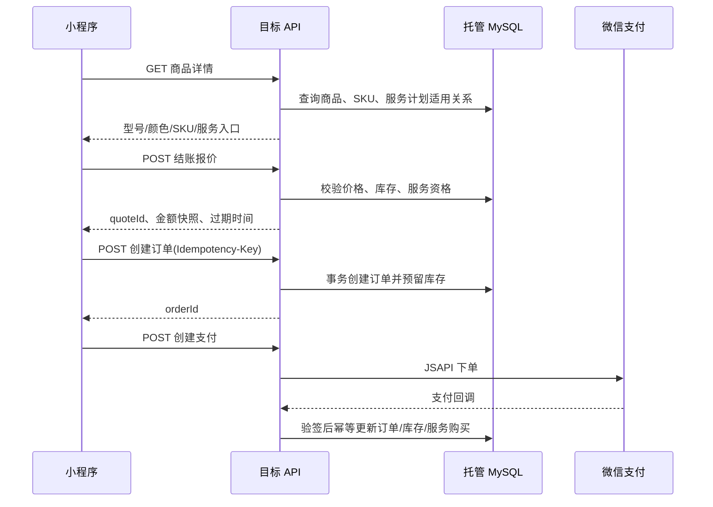

# 小程序后端 API 契约：设计

## 已知事实与设计结论

- 当前 `GET /api/v1/catalog/*` 已有只读迁移入口，商品详情返回 `products` 与 `product_specs`。
- 当前小程序将 `product_specs` 临时解释为型号；颜色从非统一字段读取；购物袋将型号、颜色、Protect 保存在本地。
- 当前确认订单仅将 `productId`、数量、`selectedColor`、优惠券和地址提交给下单接口，型号和 Protect 没有服务端订单快照。
- 因此不能在现有订单接口上追加自由文本字段后直接上线。应先建立 SKU、报价和服务计划的服务端模型，再切换小程序写接口。

## 边界与流程



## 数据模型

### 商品选配

| 实体 | 核心字段 | 说明 |
|---|---|---|
| `products` | `id`、`series`、`tool_group`、`tool_subtype`、`is_on_sale` | 商品 SPU；保留现有商品与分类数据，新增结构化目录字段须单独迁移。 |
| `product_models` | `id`、`product_id`、`name`、`sort_order` | 型号层。现有 `product_specs` 可作为迁移来源，但不能继续承担完整 SKU 语义。 |
| `product_colors` | `id`、`product_id`、`name`、`swatch`、`sort_order` | 颜色层；`swatch` 为展示色值，不替代商品图片。 |
| `product_skus` | `id`、`product_id`、`model_id`、`color_id`、`sku_code`、`price`、`stock`、`is_on_sale` | 实际可售组合；对 `(product_id, model_id, color_id)` 建唯一约束。 |
| `product_media` | `product_id`/`sku_id`、`purpose`、`object_key`、`sort_order` | 主图、轮播、详情图、档案卡图、SKU 图按用途隔离。 |

首期兼容：若商品尚未维护颜色和组合 SKU，API 可把现有 `product_specs` 映射为单颜色 SKU；不得由前端创造价格或库存。

### SRAVX Protect

| 实体 | 核心字段 | 说明 |
|---|---|---|
| `service_plans` | `id`、`code`、`name`、`status`、`terms_version` | 服务计划定义；`status` 仅允许 `draft`、`reviewing`、`active`、`retired`。 |
| `service_plan_offers` | `id`、`plan_id`、`product_id`/`sku_id`、`price`、`warranty_extension_months`、`tradein_policy_id`、`effective_rule` | 商品或 SKU 的可购买报价与生效规则。 |
| `order_service_plan_items` | `order_id`、`order_item_id`、`offer_id`、`price_snapshot`、`terms_version_snapshot`、`status` | 订单服务项快照；与订单金额一同结算。 |
| `tool_protection_entitlements` | `id`、`user_scissors_id`、`order_service_plan_item_id`、`starts_at`、`ends_at`、`status` | SN 绑定满足计划规则后生成的实际权益。 |

Protect 未审核或未配置 `active` offer 时，商品详情 API 的 `protectOffers` 必须为空；前端不能显示可加入金额的选项。

## API

统一前缀：`/api/v1`。所有金额以最小货币单位整数 `amountFen` 传输；金额展示仅由前端格式化。所有需要登录的接口通过 `Authorization: Bearer <accessToken>` 获取用户身份。

### 认证

| 方法 | 路径 | 用途 |
|---|---|---|
| `POST` | `/auth/session` | 以 `wx.login` 的 code 创建会话。 |
| `POST` | `/auth/phone` | 以微信手机号 code 绑定手机号。 |
| `POST` | `/auth/refresh` | 刷新会话。 |
| `POST` | `/auth/logout` | 吊销当前会话。 |

### 目录与选配

| 方法 | 路径 | 说明 |
|---|---|---|
| `GET` | `/catalog/home` | 首页系列、主推和服务展示数据。 |
| `GET` | `/catalog/products` | 按系列、用途、二级形态、关键字分页检索。 |
| `GET` | `/catalog/products/{productId}` | 商品详情、型号、颜色、SKU、媒体和可售服务入口。 |
| `POST` | `/checkout/quotes` | 服务器报价，替代前端价格计算。 |

`POST /checkout/quotes` 请求示例：

```json
{
  "items": [{ "skuId": 123, "quantity": 1, "protectOfferId": null }],
  "couponId": null
}
```

首期限制 `items` 长度必须为 1。响应至少包含 `quoteId`、`expiresAt`、商品与服务金额快照、库存状态、不可售原因及条款版本。

### 订单与支付

| 方法 | 路径 | 说明 |
|---|---|---|
| `POST` | `/orders` | 使用报价单创建待支付订单；请求必须带 `Idempotency-Key`。 |
| `GET` | `/orders` | 当前用户订单分页列表。 |
| `GET` | `/orders/{orderId}` | 当前用户订单与选配/服务快照。 |
| `POST` | `/orders/{orderId}/payment` | 创建微信 JSAPI 支付参数。 |
| `POST` | `/payments/wechat/notify` | 微信支付回调；不使用用户 Token，必须验签和幂等。 |
| `POST` | `/orders/{orderId}/cancel` | 取消未支付订单并释放预留库存。 |

创建订单请求只接受：`quoteId`、`addressId`、`couponId`、`remark`。服务端从报价快照写入订单行、SKU、价格、服务计划和条款版本。

### 工具档案与服务

| 方法 | 路径 | 说明 |
|---|---|---|
| `POST` | `/tools/bindings` | 绑定 SN；服务端校验 SN 状态、订单归属和幂等性。 |
| `GET` | `/tools` | 当前用户已绑定工具。 |
| `GET` | `/tools/{bindingId}` | 型号、SN 脱敏展示、激活日期、保修期、Protect 权益和售后摘要。 |
| `GET` | `/tools/{bindingId}/protection` | 已生效服务权益与条款版本。 |

## 安全与一致性

1. 客户端不得提交或覆盖价格、库存、保修期、服务权益、订单状态、OpenID、用户 ID。
2. 价格、库存预留、优惠券核销、订单服务项和积分必须在同一个订单事务边界内完成；支付回调只消费已验证的入站事件。
3. 写接口使用幂等键；支付回调以交易号、商户订单号及退款号实现唯一约束。
4. 对地址、订单、工具和服务权益按会话用户做行级归属校验；管理端使用独立管理员会话和 RBAC。
5. 身份证、人脸、学徒认证材料不进入通用用户资料或订单接口。若未来需要认证，应单独设计最小化采集、单独同意、保存期限、人工审核和删除流程。
6. COS 仅存私有对象键；小程序访问图片使用 API/受控签名 URL，不存储公开或临时 URL 作为业务事实。

## 迁移策略

- 目录读接口可继续通过现有 `migratedRead` 兼容层逐页切换。
- 订单、库存、支付、积分、优惠券、SN 绑定和 Protect 写接口不得长期双写；按照迁移计划执行停写、最终快照、校验和唯一事实库切换。
- 在目标数据库开始生产写入后，不直接回切旧库；按照迁移计划进行维护和前向修复。